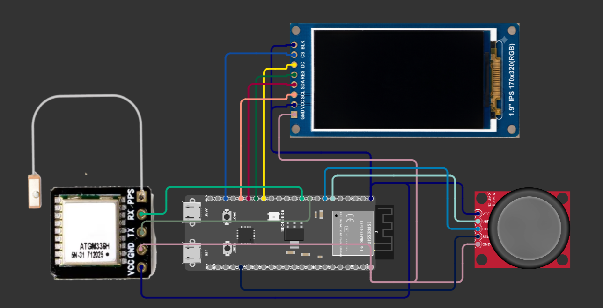

# Traqi

An open-source, handheld GPS and LoRa-based terrain game.

---

## Table of Contents
* [Current Release](#current-relase-v14-beta)
* [Hardware Schematics](#hardware-schematics)
* [Components Used](#components-used)
    * [Hardware](#hardware)
    * [Software & Technologies](#software--technologies)

---
### Current Relase: v1.4-beta

#### Added
- **Centralized Screen Architecture:** Replaced single-sketch UI logic with a modular `Screen` base class and a `ScreenManager` for screen state and transition management.
- **Games & Hunt Configuration Screens:** Added a dedicated Games menu screen and a configuration screen for the first terrain game, **"Hunt"**.
- **Hunt Game Settings:** Integrated configurable parameters for Hunt (Radius: 500m / 1km / 2km; Points: 3–15; Time limit: 30 / 45 / 60 minutes).
- **Two-State Setting Editor:** Settings editing mode featuring normal navigation and active edit mode with visual indicators (`< value >`).
- **Bidirectional Navigation:** Implemented joystick back navigation (LEFT) across screen hierarchies (Menu $\leftrightarrow$ Games $\leftrightarrow$ Hunt Settings).
- **GPS Integration:** Full UART integration for the ATGM336H GPS module, actively parsing GPS fix status, latitude, longitude, satellite count, and speed.
- **Multi-Game Architecture:** Refactored firmware foundation to support multiple modular terrain games sharing common GPS, input, display, and rendering pipelines.

#### Fixed / Improved
- **Menu Rendering Optimization:** Redraws now update only the affected menu rows instead of flushing the whole display, eliminating screen flickering.

---

## v1.3-beta

### Added
* **Footer:** Navigation information added.

### Fixed
* **Menu animation:** Fixed screen flickering issue.

## v1.2-beta

### Added
* **Screen Framework:** Foundational rendering code for display testing.
* **Boot animation:** Smooth boot-up sequence animation.
* **Provisional Menu:** Core menu system with text-highlighting animations, fully controlled via analog joystick input.

---

## Hardware Schematics

Provisional wiring layout for the joystick, screen and GPS integration:

---

## Components Used

### Hardware
* **Microcontroller:** ESP32-S3 N16R8 44-Pin Type-C Development Board
* **Display:** 1.9 inch TFT IPS LCD Display 170x320 ST7789V SPI
* **Input:** PS2 Analog Joystick Module KY-023 (XY Joystick)
* **GPS:** ATGM336H GPS Module (UART)

### Software & Technologies
* **Development Environment:** Arduino IDE 2.3.10
* **Core Framework:** Arduino-ESP32 Core (Espressif ESP32 Board Package)
* **Graphics Libraries:** Adafruit GFX Library, Adafruit ST7789 Library
* **GPS Library:** TinyGPSPlus
* **Protocols & Architecture:** SPI Communication Interface, C++ Embedded Firmware Architecture
