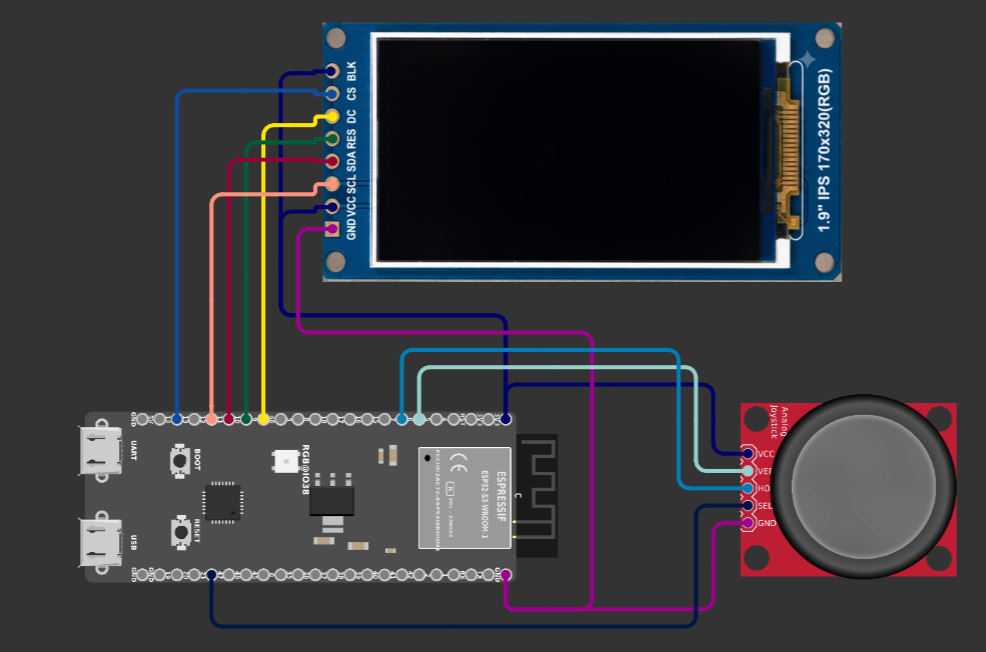

# Traqi

An open-source, handheld GPS and LoRa-based terrain game.

---

## Table of Contents
* [Current Release](#current-release-v13-beta)
* [Hardware Schematics](#hardware-schematics)
* [Components Used](#components-used)
    * [Hardware](#hardware)
    * [Software & Technologies](#software--technologies)

---

## Current Release: v1.3-beta

### Added
* **Footer:** Navigation information added.

### Fixed
* **Menu animation:** Fixed screen flickering issue.

## v1.2-beta

### Added
* **Screen Framework:** Foundational rendering code for display testing.
* **Boot animation:** Smooth boot-up sequence animation.
* **Provisional Menu:** Core menu system with text-highlighting animations, fully controlled via analog joystick input.

---

## Hardware Schematics

Provisional wiring layout for the joystick and screen integration:

---

## Components Used

### Hardware
* **Microcontroller:** ESP32-S3 N16R8 44-Pin Type-C Development Board
* **Display:** 1.9 inch TFT IPS LCD Display 170x320 ST7789V SPI
* **Input:** PS2 Analog Joystick Module KY-023 (XY Joystick)

### Software & Technologies
* **Development Environment:** Arduino IDE 2.3.10
* **Core Framework:** Arduino-ESP32 Core (Espressif ESP32 Board Package)
* **Graphics Libraries:** Adafruit GFX Library, Adafruit ST7789 Library
* **Protocols & Architecture:** SPI Communication Interface, C++ Embedded Firmware Architecture
